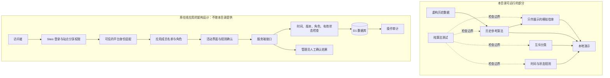
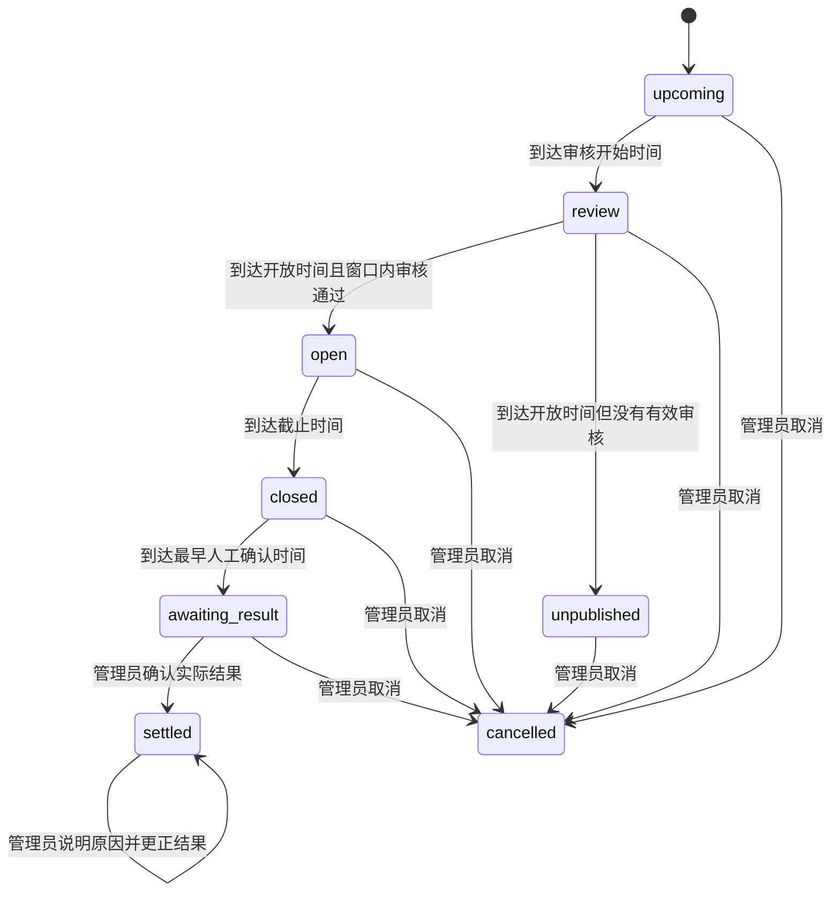

# 架构与实现边界

本页区分两件事：**公开目录里可运行的纯算法提取包**，以及**原应用采用的在线架构设计**。后者用于说明工程取舍，不表示相关服务端代码、云资源或账号权限已包含在本目录中。

所有示例都是虚构数据。本案例没有购买、转让、兑换、奖励或真实金融合约。

## 两层架构

把算法放进 `core/` 的目的，是让业务规则可以不依赖 React、云平台或真实账号单独运行。在线接口仍必须再次执行写入检查，不能仅依赖前端展示的阶段。

## 数据合同

公开的 `core/contracts.ts` 只保留算法需要的以下类型：

| 公开类型 | 职责 | 关键边界 |
| --- | --- | --- |
| `Category` / `Stage` | 四个互斥类别与活动阶段的枚举 | 枚举不替代服务端输入检查 |
| `HistoryWeek` | 一周的历史观察值与来源标记 | `confirmed` 表示数据性质；不能靠字段存在就认定真实完成 |
| `Forecast` | 样本数量、均值、分位范围、类别比例、警告与回看误差 | 是历史参考，不是确定性预测 |
| 精简 `Round` | 四个业务时间点，以及 `approvedAt`、`result`、`cancelledAt`，共七个字段 | 仅供状态计算；不含配置版本、结果版本或个人选择 |

原在线应用另有完整的期次、用户身份与页面数据对象，**没有随公开包提供**：完整期次承载设定、版本和个人选择；用户对象承载可信身份与角色；页面数据对象按访问者权限组织可见内容。这些对象需要由生产应用自行设计，不能从公开类型推断其认证或授权已经实现。

完整应用还需要成员表、期次表、选择表和审计表。个人选择使用“期次 ID + 用户 ID”的唯一键，避免同一人在同一期创建多份记录。结果判定可以由“最新实际数量 + 当期阈值 + 本人选择”计算，不需要奖励账本。

## 时间与状态机

期次以业务发生周的周一日期标识。`scheduleForWeek()` 只接受有效的周一，使用北京时间 UTC+8 生成以下时间点：

- `reviewStartsAt`：上周三 11:00。
- `opensAt`：上周三 12:30。
- `closesAt`：上周四 18:00。
- `settlesAt`：当周三 11:00。这个内部字段表示最早可人工确认的时间，不表示支付或兑奖结算。

审核窗口是 `[reviewStartsAt, opensAt)`；选择窗口是 `[opensAt, closesAt)`。在边界时刻，12:30 已不能再审核，18:00 已不能再提交选择。

`stageFor()` 只是展示状态的纯函数。原应用禁止取消已有结果的期次；更正结果与取消期次是不同操作。时区模型目前固定为 UTC+8，不应直接复制为支持任意时区和夏令时的通用调度器。

## 分类与模拟倍率

对非负整数总量 `n` 与整数阈值 `t >= 2`，四类分别为 `n = 0`、`1 <= n < t`、`n = t`、`n > t`。四类不重叠且覆盖所有合法人数。

`simulationMultiplier(p, sampleSize)` 在样本有效且 `0 < p <= 1` 时返回 `min(20, 1 / p)` 的两位小数；否则返回 `null`。显示比例可以另行四舍五入，但倍率计算应使用原始比例，避免界面反复取整放大误差。

倍率只描述参考分布的相对稀有程度，不参与购买、余额、奖励或兑现计算。这个模型也没有能力承诺任何一方“不亏”。

原应用在生成页面数据时，使用当前历史汇总和当期阈值重新计算比例与倍率，**没有为每次选择保存提交时的倍率快照**。因此，更换历史汇总或算法后，个人记录里展示的参考倍率也可能变化；它不是提交时锁定的报价。若需要复核“当时看到了什么”，应另行保存输入快照、算法版本及提交时的参考值，并明确展示当前值与历史快照的区别。

## 历史参考算法

当前纯算法采用可解释的基线，而不是已经证明有效的商业预测模型：

1. 验证周一日期与非负整数总量；排除目标周及以后记录。
2. 只保留其业务确认时刻**严格早于**本期审核开始的周。上一周的确认时间恰好与本期审核开始相同，因此保守排除，不假定数据已提前可用。
3. 同一周只计一次；总量冲突的重复周排除并给出警告，相同总量可优先保留已确认标记。
4. 选取最近 12 个有记录的可用周，并与往年同月日前后 28 天内的可用周取并集，各周等权。最近 12 个有记录周不等于最近 12 个自然周。
5. 每个类别增加 `0.5` 的轻度平滑，比例为 `(类别样本数 + 0.5) / (样本周数 + 2)`。
6. 参考范围取历史总量的 10% 与 90% 分位数并向外取整。它不是未来结果的保证区间。
7. 回看误差逐期采用相同的可用时间与取样规则，以均值作为基线。训练样本不足时跳过；只有足够的回看期数才提供 MAE，最近最多保留 12 个误差值。

不能忽略输入的语义。这里的核心验证主要针对周标识、总量和重复关系；调用方仍需核对周一、周三与其他日期的分项是否与总量一致，并明确哪些分项属于活动定义的实际结果。

没有样本时，返回值中的零均值和均匀比例是空数据占位与展示先验。界面应显示“暂无参考”，不能把这些值显示成“预计 0 人”或“历史概率 25%”。

## 平台身份与两层权限

原在线应用依赖托管平台完成登录，并由可信请求链路向服务端提供身份信息。应用侧据此匹配显式维护的成员名单，再绑定稳定的用户标识。

这是本案例的部署前提，**不是随公开代码提供的通用 OAuth 登录能力**。在任意网站直接信任浏览器可自行发送的身份头，会形成身份伪造风险。移植到其他平台时，应改用该平台支持的认证方案，并在服务端验证身份凭据；不能通过复制几个请求头获得可信登录。

访问必须同时满足两层条件：

| 层次 | 管理内容 | 不会自动完成的事 |
| --- | --- | --- |
| Sites 站点权限 | 谁能够查看、编辑该站点 | 不决定应用里的管理员或参与者角色 |
| 应用成员权限 | 哪个已认证账号可以参加活动、谁可以管理 | 不会自动把站点分享给该账号 |

管理员身份应由明确的配置或受控授权建立，不能采用“第一个访问者自动成为管理员”。普通参与者只收到自己的选择与判定；成员名单和管理审计仅提供给管理员。前端隐藏按钮不能替代这些服务端限制。

## 原应用的 D1 写入设计

以下描述来自原应用的服务端设计，公开的纯算法包不含可直接部署的 D1 接口实现。

- **提交选择**：在同一条条件写入中检查活动配置版本、有效审核、开放及截止时间、取消状态、尚无结果、成员有效性和已确认的规则版本；使用唯一键执行插入或更新。
- **审核配置**：只允许管理员在审核窗口内修改，并比较客户端提交的 `configVersion`；成功后增加版本。过期页面不能默默覆盖更新后的配置。
- **人工结果**：确认与更正分别要求“尚无结果”和“已有结果”，同时检查确认时间、有效审核与管理员角色；服务端读取 `resultVersion` 后在写入条件中比较版本，防止该次读写之间的并发覆盖。
- **角色再次检查**：管理写入的数据库条件再次验证管理员仍有效。选择写入同样重新验证成员资格，避免只相信先前读取的角色快照。
- **操作与审计绑定**：原应用使用 D1 `batch` 将业务写入与对应审计放入同一事务批次，只有实际发生变更才写入审计。没有变更时返回冲突，让客户端刷新状态。

D1 官方文档说明，`batch` 中语句按顺序执行，批次作为 SQL 事务处理；某条语句失败时会中止或回滚整个序列。这个平台语义支持上述设计，但仍需检查实际 SQL 条件和错误处理是否正确。[Cloudflare D1 `batch` 文档](https://developers.cloudflare.com/d1/worker-api/d1-database/#batch)

结果版本控制需要精确理解：服务端“读取后比较”能保护本次读写间的并发；若还需要拒绝基于过期界面作出的结果更正，应让客户端显式提交其看到的结果版本，并在服务端比较。不要把前一种保护描述成已经覆盖全部过期页面场景。

接口入口还需要同源校验、JSON 类型和请求大小限制、参数校验，以及个人响应的禁止缓存设置。生产实现应在目标 D1 环境验证事务、失败回滚及并发行为；纯函数测试不能替代这一步。

## 公开包没有验证什么

本地测试可以检查时间、分类、参考计算和模拟倍率，不能证明站点分享设置正确、平台身份不可伪造、数据库在目标环境的并发行为正确，也不能证明一个人确实完成了现实业务事件。

最终结果仍来自管理员核对的业务事实。若业务需要更强保证，可以增加复核、来源附件、结果修订记录或多方确认，但应先明确这些机制由谁维护，以及是否涉及新的隐私数据。
