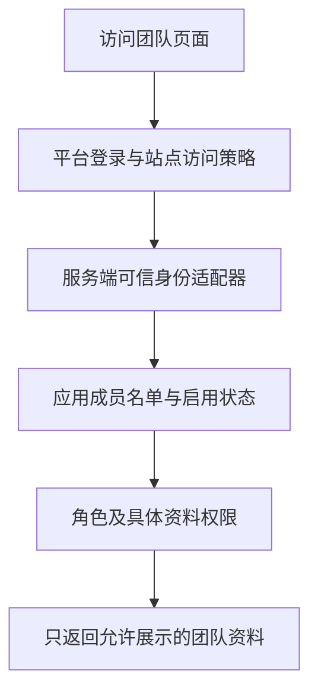

# 架构：可信身份进入，业务权限跟上

以下是本案例的建议架构，不代表已取得参考站点的服务端实现。

## 三层判断

1. **平台层**：确认访问者身份，并根据站点分享范围决定是否允许进入。应用不能通过添加名单绕过平台限制。
2. **应用层**：检查稳定用户标识是否在启用的成员名单里。邮箱格式或公司邮箱后缀本身不证明团队资格。
3. **资料层**：决定该成员能查看或修改哪些内容。管理员、参与者和页面编辑者不应混为同一个角色。

## Sites 认证的已知接口

官方说明介绍了平台提供的登录、退出路径，以及身份向服务端传递的机制；业务授权仍应由服务端完成。[官方认证说明](https://learn.chatgpt.com/docs/sites/data-and-connections)

核对本地 Sites 身份参考与认证帮助函数后，可以确认该托管集成使用 `oai-authenticated-user-id`、`oai-authenticated-user-email`，姓名是可选字段。用户 ID 在同一 Site 内稳定，但不能当作跨 Site 通用主键。公开说明与本地集成参考的证据范围分别列在 [证据说明](./evidence-and-limits.md)。

这些请求头的可信性来自托管入口的身份处理，**不来自请求头的名字**。同样名字的请求头如果从普通公网请求到达自建服务，不能直接作为身份依据。应当确保原站不可绕过可信入口，入口清除客户端同名字段并注入验证结果，或由应用独立验证受支持的身份令牌。

示例故意不提供“读取任意请求头即登录”的代码。它只接受由开发者在服务端配置的 `loadVerifiedClaims` 适配器，再校验必要字段、签发方和受众是否匹配配置。这些检查也不能替代适配器本身的签名或会话验证。

当前示例限定在**一个受信签发方、一个受众和单站点成员名单**内。内存身份标记不是租户隔离机制；不要把多个不同身份域的解析器与同一份按 `subject` 索引的名单混用。扩展到多身份源或多租户时，应使用 `(issuer, audience, subject)` 等带命名空间的授权键，并同步隔离成员、目录和资源。

## 数据与角色

建议拆开保存：

| 数据 | 用途 | 是否默认发给浏览器 |
| --- | --- | --- |
| 平台稳定用户标识、启用状态、角色 | 授权 | 否 |
| 邀请邮箱、绑定及撤销记录 | 成员管理 | 仅管理员按需读取 |
| 展示名称、小组、城市、个人介绍 | 团队目录 | 仅授权访客可见 |
| 修改审计 | 追踪操作 | 仅管理员按需读取 |

示例使用已绑定的合成用户标识，不实现“第一个访问者成为管理员”或“只要邮箱相同就自动抢占绑定”。生产环境如果使用邮箱邀请，首次绑定必须依据已验证的邮箱身份，并通过原子更新防止重复绑定。

| 操作 | 启用成员 | 启用管理员 | 未入名单或停用账号 |
| --- | --- | --- | --- |
| 查看启用成员的展示目录 | 可以 | 可以 | 拒绝 |
| 修改自己的介绍 | 可以 | 可以 | 拒绝 |
| 修改他人的介绍 | 拒绝 | 可以 | 拒绝 |
| 管理成员名单 | 拒绝 | 可以 | 拒绝 |

角色来自服务端名单。身份里的显示名、邮箱后缀、前端传来的 `role` 都不能授予管理权限。每次操作重新检查当前名单，不能只在首次登录时检查。

## 示例没有实现的生产能力

示例只运行纯策略与数据投影，不启动 HTTP 服务，也不持久化修改。它证明的是这些策略在合成输入下的行为。

接入真实写接口时，还需实现同源请求校验、参数验证、数据库原子授权条件、审计记录及并发控制；前端隐藏按钮不能代替这些检查。目录响应仅包含展示字段，不返回邮箱、内部账号标识或管理员名单。
